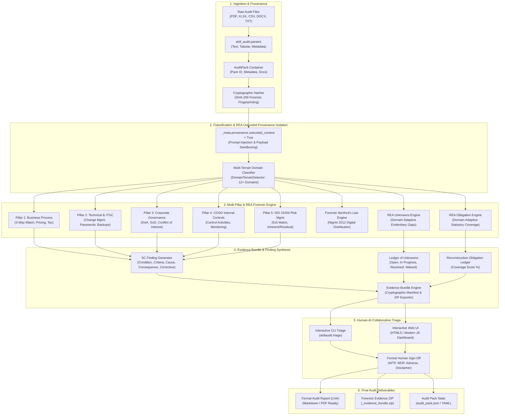
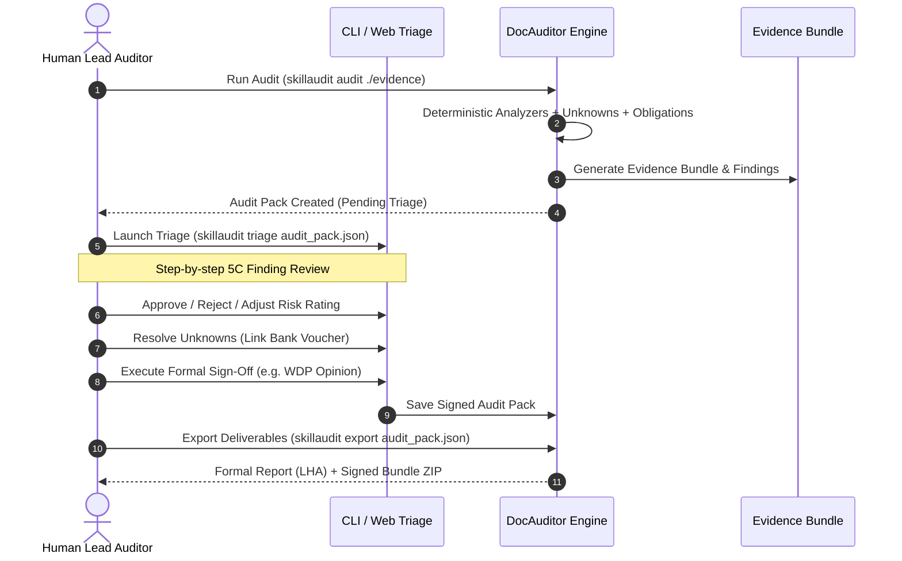

# Architecture & Design Blueprint: Audit Anything (DocAuditor)

> **Forensic Enterprise Auditing Engine with `morluto/rea` Methodology & Human-AI Collaboration**

---

## 1. System Overview

**Audit Anything (`docauditor`)** is a deterministic, offline-first enterprise audit and evidence forensics framework. It combines deep multi-pillar enterprise audit analysis (Business Process, ITGC, Corporate Governance, COSO, ISO 31000) with the reverse-engineering forensics of [morluto/rea](https://github.com/morluto/rea) (Ledger of Unknowns, Reconstruction Obligations, Cryptographic Evidence Bundles, and Untrusted Boundary Isolation).



---

## 2. The 5 Enterprise Audit Pillars

| Pillar | Focus Area | Standard / Methodology | Verification Engine |
|---|---|---|---|
| **1. Business Process** | Procurement, Billing, 3-Way Matching, PPN/PPh Taxes | IFRS, Tax Code (UU HPP No. 7/2021) | `EnterpriseAnalyzer` (3-Way tolerance match, tax rate verification) |
| **2. Technical & ITGC** | Change management, access controls, backups, logging | Cobit 2019, ISO 27001:2022 | Verifies audit trails, backup frequency, password policies, privileged accounts |
| **3. Corporate Governance** | Delegation of Authority (DoA), Segregation of Duties (SoD) | OECD Governance Principles, SOX 404 | Verifies approval thresholds, dual authorizations, conflicting role matrix |
| **4. COSO Internal Control** | 5 COSO components (Environment, Risk, Activities, Info, Monitoring) | COSO Framework 2013 | Maps controls against 17 COSO principles, identifies control design flaws |
| **5. ISO 31000 Risk Mgmt** | Inherent vs. Residual risk quantification, 5x5 Matrix | ISO 31000:2018 | Computes risk scores ($L \times I$), assigns mitigation priorities |

---

## 3. `morluto/rea` Reverse-Engineering Forensic Methodology

The system adapts the core principles of [morluto/rea](https://github.com/morluto/rea) to enterprise audit forensics:

```
┌────────────────────────────────────────────────────────────────────────┐
│                        morluto/rea Core Tenets                         │
├──────────────────────────┬─────────────────────────────────────────────┤
│ REA Reverse-Engineering  │ Skill-Audit Enterprise Forensic Equivalence │
├──────────────────────────┼─────────────────────────────────────────────┤
│ Ledger of Unknowns       │ Ledger of Audit Unknowns (Missing Docs/Gaps)│
│ Reconstruction Obligation│ Statutory & Regulatory Compliance Ledger    │
│ Cryptographic Evidence   │ SHA-256 Tamper-Evident Evidence Bundles     │
│ Untrusted Input Sandbox  │ Prompt-Injection Provenance Boundary Walls  │
│ Human Reverser Sign-Off  │ Human Auditor Formal Opinion Sign-Off Sheet │
└──────────────────────────┴─────────────────────────────────────────────┘
```

### 3.1 Untrusted Content Isolation Boundary
Audited files (contracts, invoices, logs) can contain malicious prompt-injection payloads or deceptive text crafted to mislead automated LLMs. The engine automatically tags document payloads:
```python
doc.metadata["_meta"] = {
    "provenance": {
        "untrusted_content": True,
        "source_path": str(file_path),
        "sha256": calculate_sha256(content),
    }
}
```
Any downstream LLM integration or analyzer is instructed to treat document content strictly as data payloads, neutralizing prompt-injection vulnerabilities.

### 3.2 Ledger of Unknowns
Unknowns represent what cannot be definitively proven from available evidence:
- **Missing Payments**: Invoices marked paid without bank vouchers or receipts.
- **Missing Delivery (BAST)**: Paid hardware/software without hand-over certificates.
- **Missing Tax Documents**: Invoices with PPN missing e-Faktur seri numbers.
- **Missing Signatures**: Contracts exceeding threshold without Director approval.

Each item maintains an explicit status lifecycle: `OPEN` $\rightarrow$ `IN_PROGRESS` $\rightarrow$ `RESOLVED` (with resolution note) or `WAIVED` (with risk justification).

### 3.3 Reconstruction Obligation Ledger
Auditors cannot issue an unqualified opinion if statutory rules are omitted. The obligation engine tracks mandatory compliance items:
1. 3-Way Matching (PO vs. BAST vs. Invoice)
2. Indonesian PPN 11% Statutory Rate Check
3. Bea Meterai (Rp 10.000 for transactions $> Rp 5.000.000$)
4. Delegation of Authority Approval Limit Compliance
5. Segregation of Duties (Purchaser $\neq$ Approver)
6. Transaction Timeline Integrity (PO date $\le$ BAST $\le$ Invoice)
7. Anti-Bribery & Due Diligence (ISO 37001)

Coverage is computed deterministically:
$$\text{Obligation Coverage} = \frac{\text{Satisfied Obligations}}{\text{Total Mandatory Obligations}} \times 100\%$$

### 3.4 Cryptographic Evidence Bundles
Every finding is cryptographically tied to exact document hashes:
- `manifest.json`: Contains document SHA-256 fingerprints, file sizes, finding hashes, unknown hashes, and human sign-off state.
- `verify_evidence_bundle()`: Evaluates byte integrity on disk against recorded hashes, raising cryptographic tampering alerts if files were modified post-audit.
- `_evidence_bundle.zip`: Portable evidence container for court, regulator, or executive inspection.

---

## 4. Human-AI Collaborative Triage Layer

The system guarantees that **AI acts as the exhaustive investigative copilot, while Human Auditors retain legal and professional authority**.



### Audit Opinion Framework (SA 700 / 705)
1. **WTP (Wajar Tanpa Pengecualian / Unqualified Opinion)**:
   - High obligation coverage ($\ge 90\%$).
   - Zero open critical unknowns.
   - All high/critical findings either remediated or confirmed within acceptable risk limits.
2. **WDP (Wajar Dengan Pengecualian / Qualified Opinion)**:
   - Specific, isolated gaps or non-pervasive scope limitations.
   - Identified open unknowns with moderate impact.
3. **Adverse (Tidak Wajar)**:
   - Pervasive control failures (e.g., widespread fake invoicing, systemic DoA bypass).
4. **Disclaimer (Tidak Memberikan Pendapat)**:
   - Critical scope limitations; missing vital core records preventing audit execution.

---

## 5. Directory & Module Structure

```
SKILLAUDIT/
├── skill_audit/                    # Core Python Package
│   ├── __init__.py                 # Version & public API
│   ├── models.py                   # Data models (AuditPack, Finding5C, UnknownItem, etc.)
│   ├── engine.py                   # Central AuditEngine pipeline orchestrator
│   ├── triage.py                   # Interactive rich terminal triage workflow
│   ├── evidence_bundle.py          # Cryptographic hashing & tamper-verification engine
│   ├── cli.py                      # Typer CLI commands & argument handlers
│   ├── parsers/                    # Multi-format document ingestion
│   │   ├── __init__.py
│   │   ├── pdf_parser.py           # PDF text & layout extraction
│   │   ├── docx_parser.py          # Word document extraction
│   │   ├── spreadsheet_parser.py   # Excel & CSV data parsing
│   │   └── text_parser.py          # Plain text, markdown, log parser
│   ├── analyzers/                  # Multi-pillar deterministic analyzers
│   │   ├── __init__.py
│   │   ├── enterprise_analyzer.py  # 5 Pillars (Process, ITGC, Governance, COSO, ISO31000)
│   │   ├── matching_engine.py      # 3-Way PO-BAST-Invoice reconciliation
│   │   ├── unknowns_engine.py      # REA gap detection & lifecycle management
│   │   └── obligation_engine.py    # Statutory & regulatory compliance coverage
│   └── exporters/                  # Audit report generators
│       ├── __init__.py
│       ├── report_exporter.py      # Markdown LHA with 10 structured chapters
│       └── web_exporter.py         # Standalone HTML5/JS interactive review dashboard
├── skills/
│   └── document-auditor/
│       └── SKILL.md                # Agent Skill definition for AI coding assistants
├── tests/                          # 100% Passing Pytest Test Suite
│   ├── test_models.py
│   ├── test_parsers.py
│   ├── test_analyzers.py
│   ├── test_enterprise_pillars.py
│   ├── test_grounding.py
│   ├── test_validation.py
│   ├── test_exporters.py
│   ├── test_cli.py
│   └── test_rea_collaboration.py
├── ARCHITECTURE.md                 # System architecture blueprint (This file)
├── COLLABORATION.md                # Human-AI collaborative triage playbook
├── REA_METHODOLOGY.md              # Deep dive into REA forensic principles
├── CONTRIBUTING.md                 # Developer contribution guidelines
├── README.md                       # Project overview and user guide
└── pyproject.toml                  # Python package configuration
```

---

## 6. Security & Determinism Guarantee

1. **100% Offline by Default**: No document bytes, hashes, or audit findings are transmitted to cloud endpoints without explicit operator configuration.
2. **Zero Hallucination Anchoring**: Every finding requires exact verbatim quotes from the underlying source documents (`Finding5C.quote_anchor`).
3. **Cryptographic Tamper-Evidence**: If any document in the evidence bundle is modified by even 1 bit, `skillaudit verify-bundle` detects the mismatch and invalidates the audit certificate.
4. **Sanitized Output**: All report exporters escape markdown and HTML injections from analyzed files.
