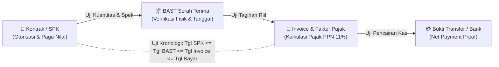

<p align="center">
  <h1 align="center">🔍 Skill-Audit</h1>
  <p align="center"><b>Comprehensive Document & Audit Dossier Analyzer, 3-Way Matching Engine, and AI Agent Skill</b></p>
</p>

<p align="center">
  <a href="LICENSE"></a>
  <a href="https://www.python.org"></a>
  
  
  
</p>

<p align="center">
  <a href="#ringkasan--filosofi">Filosofi</a> •
  <a href="#fitur-utama">Fitur Utama</a> •
  <a href="#quick-start">Quick Start</a> •
  <a href="#arsitektur-output">Arsitektur Output</a> •
  <a href="#uji-silang--3-way-matching">3-Way Matching</a> •
  <a href="#standar-temuan-5c">Metodologi 5C</a> •
  <a href="#cli-reference">CLI Reference</a> •
  <a href="#instalasi-plugin--skill">Instalasi Plugin Skill</a> •
  <a href="#python-api">Python API</a>
</p>

---

## 📌 Ringkasan & Filosofi

Diinspirasi oleh arsitektur modular **[SYuan03/Skill-Anything](https://github.com/SYuan03/Skill-Anything)** yang mentransformasi materi mentah menjadi paket pembelajaran terstruktur dengan kutipan bukti terverifikasi (*verifiable source quotes*), **Skill-Audit** dirancang khusus untuk domain audit forensik, keuangan, kepatuhan, dan pengadaan dokumen:

> **Skill-Audit mengubah berkas dokumen mentah (PDF, Excel, Word, teks, atau map berkas/dossier ZIP) menjadi AuditPack terstruktur, Laporan Hasil Audit (LHA) formal berstandar 5C, Kertas Kerja Audit (KKA), dasbor web interaktif offline, dan AI Agent Skill yang siap dipasang pada asisten AI seperti Google Antigravity, Claude Code, dan Cursor.**

---

## ✨ Fitur Utama

- 📑 **Multi-Source Ingestion**: Mendukung dokumen PDF (`.pdf`), spreadsheet Excel & CSV (`.xlsx`, `.csv`), Microsoft Word (`.docx`), teks/markdown (`.txt`, `.md`), serta folder berkas atau arsip ZIP berisi map dossier lengkap.
- ⚖️ **Uji Silang & 3-Way Matching Otomatis**: Melakukan rekonsiliasi nilai, kuantitas, dan tanggal antar-dokumen: **Kontrak/SPK ⟷ BAST (Berita Acara Serah Terima) ⟷ Invoice ⟷ Bukti Transfer Bank**.
- 🧮 **Uji Aritmatika & Pajak Substantif**: Menghitung ulang kebenaran perkalian kuantitas × harga satuan, akurasi pemungutan PPN 11% (UU HPP No. 7/2021), PPh pasal 21/22/23, dan mendeteksi selisih hitung tagihan.
- ⏱️ **Deteksi Anomali & Fraud Red Flags**:
  - *Premature / Backdated Billing*: Invoice bertanggal lebih awal dari BAST fisik.
  - *Perikatan Post-Factum*: SPK/Kontrak bertanggal setelah barang/jasa diserahkan.
  - *Pemecahan Paket (Split Purchasing)*: Memecah transaksi mendekati ambang batas tender (Rp 50.000.000) untuk menghindari lelang.
  - *Ketiadaan Bea Meterai*: Transaksi bernilai $\ge$ Rp 5.000.000 tanpa bukti meterai sah (UU Bea Meterai No. 10/2020).
  - *Ketiadaan Otorisasi*: Berkas tanpa pengesahan tanda tangan berwenang.
- 🎯 **Verifiable Evidence Grounding (Zero Hallucination)**: Setiap temuan audit wajib memiliki kutipan teks verbatim dan nomor lokasi dokumen (halaman, nomor baris, pasal). Temuan tanpa bukti nyata langsung ditolak.
- 🌐 **Dasbor Web Interaktif Mandiri (Single-File Offline HTML)**: Satu file `index.html` tanpa ketergantungan internet/CDN. Memuat pencarian temuan real-time, filter tingkat risiko, kartu temuan 5C, tabel rekonsiliasi, dan tata letak siap cetak (*print-to-PDF ready*).
- 🤖 **Instalasi Plugin / AI Skill Siap Pakai**: Dilengkapi format standar `SKILL.md` dengan panduan prompt, referensi audit, dan skrip CLI yang langsung dapat diintegrasikan ke sistem agen AI.
- 🛡️ **Pintu Gerbang CI/CD (`--strict`)**: Perintah `skillaudit verify pack.yaml --strict` untuk memastikan integritas data audit sebelum dipublikasikan.

---

## 🚀 Quick Start

### 1. Instalasi Repositori Git

Clone repositori ini dan instal dependensinya:

```bash
git clone https://github.com/username/skill-audit.git
cd skill-audit

# Instal mode pengembangan lokal
pip install -e . --break-system-packages
```

Periksa ketersediaan CLI:
```bash
skillaudit --help
```

---

### 2. Mengaudit Dokumen atau Berkas Dossier

#### A. Mengaudit Dokumen Tunggal (PDF, Word, Excel, Teks)
```bash
skillaudit doc path/to/kontrak.docx --format all
```

#### B. Mengaudit Berkas Audit Keseluruhan (Dossier Folder / ZIP)
```bash
skillaudit dossier examples/procurement_dossier/ --format all -o output/hasil_audit
```

#### C. Melakukan Uji Silang Terarah (3-Way Matching)
```bash
skillaudit cross-check \
  examples/procurement_dossier/01_SPK_Kontrak_Pengadaan.txt \
  examples/procurement_dossier/02_BAST_Serah_Terima.txt \
  examples/procurement_dossier/03_Invoice_Tagihan_Vendor.txt \
  -o output/uji_silang
```

#### D. Memvalidasi Kualitas AuditPack (CI/CD Quality Gate)
```bash
skillaudit verify output/hasil_audit/aud_procurement_dossier_01_pack.yaml --strict
```

#### E. Membuat Paket Berbagi Siap Kirim (Offline HTML + ZIP)
```bash
skillaudit share output/hasil_audit/aud_procurement_dossier_01_pack.yaml -o output/paket_klien
```

---

## 📦 Arsitektur Output

Setiap proses audit menghasilkan paket deliverables lengkap:

```text
output/
├── aud_procur_01_pack.yaml               # Basis data AuditPack terstruktur
├── aud_procur_01_Laporan_Hasil_Audit.md   # Laporan Hasil Audit (LHA) formal standar 5C
├── aud_procur_01_Kertas_Kerja_Audit.md   # Kertas Kerja Audit (KKA) uji kepatuhan
├── aud_procur_01_dashboard.html          # Dasbor web interaktif offline (buka di browser)
├── aud_procur_01_findings.csv            # Matriks temuan siap buka di Excel/Sheets
└── audit-berkas-procurement-dossier/     # Agent Skill siap pakai
    ├── SKILL.md                          # Definisi AI Agent Skill
    ├── references/                       # Panduan metodologi 5C & 3-way matching
    ├── assets/                           # Data pack & checklist YAML
    └── scripts/                          # Skrip CLI mandiri runner
```

---

## ⚖️ Uji Silang & 3-Way Matching

Sistem secara cerdas memetakan dokumen dalam dossier ke dalam fungsi perikatan:



---

## 🏛️ Standar Temuan 5C (The 5C Methodology)

Setiap temuan disusun berdasarkan kaidah standar audit internasional (IIA & BPK):

1. **Condition (Kondisi)**: Fakta riil temuan empiris di dokumen yang dilengkapi kutipan verbatim sumber.
2. **Criteria (Kriteria)**: Standar regulasi (UU/PP/Perpres), SAK, atau klausul perjanjian yang semestinya ditaati.
3. **Cause (Sebab)**: Akar penyebab mengapa deviasi terjadi.
4. **Consequence (Akibat)**: Kuantifikasi risiko finansial, sanksi administrasi, atau kerugian hukum.
5. **Recommendation (Rekomendasi)**: Solusi perbaikan konkrit, terukur, dan berorientasi pencegahan.

---

## 🔌 Instalasi Plugin / Skill ke Asisten AI

Untuk memasang keahlian audit dokumen ke asisten AI Anda secara otomatis:

### Ke Google Antigravity
```bash
skillaudit install-skill --target antigravity
```
*Skill langsung disalin ke repositori global `antigravity-skills-manager` dan aktif digunakan agen Antigravity.*

### Ke Claude Code
```bash
skillaudit install-skill --target claude
```

### Ke Cursor / Windsurf
```bash
skillaudit install-skill --target cursor
```

---

## 💻 CLI Reference

| Perintah | Deskripsi | Opsi Utama |
|:---|:---|:---|
| `skillaudit doc <file>` | Audit dokumen tunggal (PDF, Excel, Docx, Text) | `-o <dir>`, `-f [pack\|report\|web\|all]` |
| `skillaudit dossier <path>` | Audit map berkas dossier / ZIP multi-dokumen | `-o <dir>`, `-c <checklist.yaml>` |
| `skillaudit cross-check <f1> <f2>...` | Uji silang & rekonsiliasi terarah | `-o <dir>`, `-t <title>` |
| `skillaudit verify <pack.yaml>` | Validasi integritas dan bukti sumber | `--strict`, `--json` |
| `skillaudit export <pack.yaml>` | Ekspor pack ke format laporan tertentu | `-f [report\|web\|csv\|skill\|all]` |
| `skillaudit share <pack.yaml>` | Buat dasbor web offline + bundel ZIP | `-o <dir>` |
| `skillaudit install-skill` | Pasang skill ke Antigravity / Claude / Cursor | `-t [antigravity\|claude\|cursor]` |
| `skillaudit info <pack.yaml>` | Tampilkan ringkasan metrik terminal | — |

---

## 🐍 Python API

Anda juga dapat mengintegrasikan Skill-Audit langsung ke dalam kode Python atau pipeline analitik:

```python
from skill_audit.engine import AuditEngine
from skill_audit.exporters import ReportExporter, WebExporter

# Inisialisasi engine audit
engine = AuditEngine()

# Jalankan audit berkas dossier
pack = engine.audit("examples/procurement_dossier")

# Cetak ringkasan metrik
print(f"Skor Kepatuhan: {pack.metrics.compliance_score}%")
print(f"Total Temuan: {len(pack.findings)}")

# Ekspor laporan
web_exporter = WebExporter()
web_exporter.export(pack, "output/dashboard.html")
```

---

## 🧪 Menjalankan Pengujian (Unit Tests)

```bash
pytest -v
```
Seluruh 27 tes unit terintegrasi mencakup pengujian model, parser, grounding kutipan, kalkulasi aritmatika, uji kronologi tanggal, deteksi pemecahan paket, validasi CI/CD, dan eksportir laporan.

---

## 📄 Lisensi

Proyek ini dilisensikan di bawah [MIT License](LICENSE).
