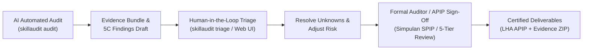

# Auditor-Anything (Universal Document Auditor) — AI Agent Skill

This skill equips the AI agent with a universal, multi-terrain operational doctrine to audit **any document, spreadsheet, system log, contract, or dossier across any domain or industry ("Segala Medan")**.

---

## 1. Universal Terrain Capabilities ("Segala Medan")

The engine automatically classifies and adapts audit procedures across 12+ operational domains:

1. **Procurement & Contracting (`PROCUREMENT`)**:
   - 3-Way Matching (PO vs. BAST vs. Invoice vs. Payment).
   - Perpres No. 16/2018 jo Perpres 12/2021 & LKPP procurement guidelines.
   - Tender collusion detection (bid rigging), split transactions, vendor cartel indicators.
2. **Financial & Accounting (`FINANCIAL`)**:
   - SAK / PSAK / IFRS compliance and cut-off testing.
   - General Ledger to Subledger reconciliations (AR/AP/Inventory).
   - Monthly bank statement reconciliation, unrecorded disbursements, and lapping/kiting detection.
3. **Public Sector, APIP & Government (`GOVERNMENT`)**:
   - **PER-01/AAIPI/DPN/2021**: Standar Audit Intern Pemerintah Indonesia (SAAIPI) issued by AAIPI.
   - PP No. 60/2008 (SPIP), Standar Akuntansi Pemerintahan (SAP / PP 71/2010), UU Keuangan Negara No. 17/2003, UU No. 1/2004.
   - APIP Code of Ethics: Integrity, Objectivity, Confidentiality, Competence, Accountability, Professional Behavior.
   - Standar Atribut (1000 Internal Audit Charter, 1100 Conflict of Interest Declaration, 1200 Due Care, 1300 QAIP).
   - Standar Pelaksanaan (2000 Risk-Based PKPT, 2200 Official Audit Assignment Letter, 2300 Multi-Tier KKA, 2400 5C LHA & Auditee Response, 2500 TLRHP Monitoring).
   - DPA/RKA budget cap monitoring, SiLPA variance analysis, SPP/SPM/SP2D treasury trail, and BMD/BMN reconciliation.
4. **Healthcare & Hospital Billing (`HEALTHCARE`)**:
   - BPJS Kesehatan anti-fraud guidelines, Permenkes No. 24/2022 (Rekam Medis).
   - ICD-10 and INA-CBG upcoding detection, double billing, phantom billing.
   - Controlled narcotics/psychotropics register reconciliation (SIPNAP) and patient informed consent.
5. **Human Resources & Payroll (`HR_PAYROLL`)**:
   - UU No. 6/2023 (Cipta Kerja), PP 35/2021 (PKWT & PHK), PP 36/2021 (Pengupahan).
   - Ghost employee detection (duplicate bank accounts, duplicate NIK, post-resignation pay).
   - Overtime limits (max 4 hrs/day, 18 hrs/week), BPJS TK/Kes contributions, and PPh 21 TER calculations.
6. **Supply Chain & Operational Logistics (`SUPPLY_CHAIN`)**:
   - PSAK 14 (Persediaan) and Warehouse Management System (WMS) standards.
   - Physical Stock Opname reconciliation (BASO discrepancy tolerance $\le 2\%$).
   - Dead-stock and slow-moving aging ($> 180$ days), negative inventory balances, unauthorized write-offs.
7. **Forensic Investigation & Anti-Fraud (`FORENSIC_FRAUD`)**:
   - Benford's Law first-digit digital analysis (Nigrini 2012, ISA 240 / SA 240).
   - ACFE Fraud Tree, kickbacks, related-party concealment, weekend/holiday journal entries.
   - ISO 37001:2016 Sistem Manajemen Anti Penyuapan (SMAP) & Pakta Integritas.
8. **Cybersecurity & IT Controls (`IT_SECURITY`)**:
   - ISO/IEC 27001:2022, COBIT 2019, NIST CSF, and UU PDP No. 27/2022.
   - IT General Controls (ITGC): User Access Reviews, MFA, CAB Change Management, Backup Restoration testing.
   - Prevention of plaintext credentials, token leaks, and shared privileged accounts.
9. **Taxation & Customs (`TAX_CUSTOMS`)**:
   - UU HPP No. 7/2021, statutory PPN 11%, withholding tax (PPh 21, 23, 4(2), 25).
   - e-Faktur QR code verification, fictitious invoice detection, customs import/export (PIB/PEB).
10. **Banking, Fintech & AML (`BANKING_FINTECH`)**:
    - POJK APU-PPT (Anti-Pencucian Uang & Pencegahan Pendanaan Terorisme), UU No. 8/2010 TPPU.
    - Customer Due Diligence (CDD), Enhanced Due Diligence (EDD), and smurfing/structuring detection.
    - Financial soundness ratios (CAR, NPL, LDR, NIM, BOPO).
11. **ESG & Sustainability (`ESG_SUSTAINABILITY`)**:
    - POJK No. 51/POJK.03/2017 (Keuangan Berkelanjutan), UU No. 32/2009 (Lingkungan Hidup).
    - Scope 1, 2, 3 carbon emission verification, greenwashing detection.
    - Hazardous waste (Limbah B3) manifests and mandatory CSR/TJSL realization.
12. **Legal & Contractual Compliance (`LEGAL_CONTRACT`)**:
    - KUHPerdata perikatan, SLA compliance, penalty clauses, liability caps, dispute resolution.

---

## 2. Advanced Mathematical Forensics: Benford's Law

The skill incorporates **Nigrini (2012) Digital Analysis** to uncover manufactured numbers, manipulated accounting entries, and fictitious expenses:
- Expected digit distribution: $P(d) = \log_{10}(1 + 1/d)$ for $d \in \{1 \dots 9\}$.
- Mean Absolute Deviation (MAD):
  $$\text{MAD} = \frac{1}{9} \sum_{d=1}^{9} \left| \frac{N(d)}{N_{total}} - P_{exp}(d) \right|$$
  - $\text{MAD} \le 0.006$: *Close Conformity*
  - $0.006 < \text{MAD} \le 0.012$: *Acceptable Conformity*
  - $0.012 < \text{MAD} \le 0.015$: *Marginally Acceptable*
  - $\text{MAD} > 0.015$: *Non-Conforming* $\rightarrow$ Automatically flags anomalous digits and triggers **100% substantive forensic testing**!

---

## 3. Reverse-Engineering Forensics (`morluto/rea` Integration)

1. **Untrusted Provenance Boundary**:
   All audited files are tagged `_meta.provenance.untrusted_content = True` to isolate documents from executing instructions or hijacking LLM agent prompts.
2. **Ledger of Unknowns & Inquiries (`UnknownsEngine`)**:
   Evidentiary gaps are never assumed or hallucinated; they are registered into the Unknowns Ledger (`OPEN` $\rightarrow$ `RESOLVED` / `WAIVED`).
3. **Reconstruction Obligation Ledger (`ObligationEngine`)**:
   Statutory and domain-specific regulations are tracked as mandatory obligations, yielding a quantitative compliance coverage score.
4. **Cryptographic Evidence Bundles (`evidence_bundle`)**:
   Every document, finding, and unknown is bound to deterministic SHA-256 digests. `skillaudit verify-bundle` detects any post-audit document tampering.

---

## 4. Human-AI Collaborative Triage Workflow



---

## 5. Public Sector & APIP Audit Framework (PER-01/AAIPI/DPN/2021 SAAIPI)

### Doktrin Pengawasan APIP vs Pemeriksaan BPK

| Aspek Pembeda | Pengawasan Intern APIP (PER-01/AAIPI/DPN/2021 & PP 60/2008) | Pemeriksaan Ekstern BPK (UU 15/2004 & SPKN) |
|:---|:---|:---|
| **Peran & Kedudukan** | **Mitra Strategis (*Strategic Partner*) & Peringatan Dini (*Early Warning System*)** bagi pimpinan | Pemeriksa eksternal independen judisial untuk DPR/DPRD/Publik |
| **Bentuk Pernyataan** | **Simpulan Efektivitas 3 Pilar SPIP** (*Sangat Efektif, Cukup Efektif dg Catatan, Kurang Efektif, Tidak Efektif*) / *Pernyataan Telah Direviu* | **Opini Laporan Keuangan** (*WTP, WDP, Tidak Wajar / TW, Menolak Memberikan Opini / TMP*) |
| **Fokus Pengujian** | Keandalan Tata Kelola (GCG), Manajemen Risiko (ERM), dan Sistem Pengendalian Intern (SPIP) | Kepatuhan UU, Akuntabilitas Fiskal, Kerugian Negara & Tuntutan Ganti Rugi (TGR) |
| **Format Dokumen** | **Laporan Hasil Audit/Pengawasan (LHA APIP)** dengan Bab I - Bab V | **Laporan Hasil Pemeriksaan (LHP BPK)** Buku I, II, III |
| **Hierarki Pengesahan** | **5-Tier Tim Pengawasan**: Anggota Tim (AT) $\rightarrow$ Ketua Tim (KT) $\rightarrow$ Dalnis $\rightarrow$ Dalmutu (PM/Irban) $\rightarrow$ Inspektur | Penanggung Jawab Pemeriksaan BPK & Anggota BPK |
| **Tindak Lanjut** | **TLRHP 4 Kategori Baku SAAIPI 2500** bersama Auditee (Rencana Aksi PIC) | Pemantauan Kerugian Negara / Sidang TGR Majelis BPK |

1. **Prinsip Etika APIP**:
   - **Integritas**: Kejujuran, keteguhan moral, dan keberanian menegakkan kebenaran.
   - **Objektivitas**: Penilaian netral, bebas benturan kepentingan (*conflict of interest*), berbasis bukti nyata.
   - **Kerahasiaan**: Melindungi informasi rahasia dinas, tidak membocorkan data negara.
   - **Kompetensi**: Keahlian teknis (JFA/CIPA/CRMO), kepatuhan SAAIPI, dan kewajiban PPL/CPE.
   - **Akuntabilitas**: Mempertanggungjawabkan seluruh simpulan dan memelihara jejak KKA.
   - **Perilaku Profesional**: Mematuhi hukum, etika kedinasan, dan menjaga kehormatan korps auditor.

2. **Standar Atribut (Seri 1000)**:
   - `1000`: Mandat Pengawasan & Piagam Audit Intern (*Internal Audit Charter*) disetujui Pimpinan Instansi.
   - `1100`: Independensi Organisasi & Deklarasi Bebas Benturan Kepentingan Individual.
   - `1200`: Keahlian & Kecermatan Profesional (*Due Professional Care* & Skeptisisme Fraud).
   - `1300`: Program Penjaminan dan Peningkatan Kualitas (*QAIP* & Telaah Sejawat AAIPI).

3. **Standar Pelaksanaan (Seri 2000)**:
   - `2000`: Pengelolaan Audit Intern berbasis Program Kerja Pengawasan Tahunan (PKPT) Berbasis Risiko.
   - `2100`: Evaluasi Tata Kelola, Manajemen Risiko, dan Pengendalian Intern Pemerintah (SPIP PP 60/2008).
   - `2200`: Perencanaan Penugasan, Surat Tugas Resmi (ST), dan Struktur Tim Hierarkis (PM, Dalnis, KT, AT).
   - `2300`: Bukti Audit Memadai (Cukup, Kompeten, Relevan, Andal) dan Kertas Kerja Audit (KKA) Berjenjang.
   - `2400`: Pelaporan LHA Berbasis 5C (Condition, Criteria, Cause, Consequence, Recommendation) & Tanggapan Resmi Auditi.
   - `2500`: Pemantauan Tindak Lanjut Rekomendasi Hasil Pengawasan (TLRHP) 4 Status:
     * *Status 1*: Sesuai Rekomendasi / Selesai
     * *Status 2*: Belum Sesuai Rekomendasi / Dalam Proses
     * *Status 3*: Belum Ditindaklanjuti
     * *Status 4*: Tidak Dapat Ditindaklanjuti dengan Alasan Sah

---

## 6. CLI Execution Reference

```bash
# 1. Universal Audit Across Any Domain (Auto-detect Domain & Standards)
skillaudit audit path/to/dossier/ --output output/ --format all

# 2. SAAIPI PER-01/AAIPI/DPN/2021 Compliance Evaluation (Table & JSON)
aipi output/audit_pack.yaml --json
skillaudit saaipi output/audit_pack.yaml --json

# 3. Inspect Operational Audit Terrain
skillaudit terrain path/to/dossier/

# 4. Run Forensic Benford's Law Digital Analysis
skillaudit benford output/audit_pack.yaml

# 5. List All Universal Domain Profiles & Standards
skillaudit profiles

# 6. Review Unknowns & Statutory Obligations
skillaudit unknowns output/audit_pack.yaml
skillaudit obligations output/audit_pack.yaml

# 7. Verify Cryptographic Evidence Integrity (Tamper Detection)
skillaudit verify-bundle output/audit_pack.yaml

# 8. Interactive Human-AI Triage & Formal APIP Sign-Off
skillaudit triage output/audit_pack.yaml
skillaudit signoff output/audit_pack.yaml \
  --conclusion efektif_dengan_catatan \
  --kt "Drs. Bambang Wijaya, Ak., CA, CRMO" \
  --dalnis "Dr. Suryadi, Ak., M.Ak, CIA" \
  --pm "Hj. Ratna Sari, SE., M.Si" \
  --inspektur "Ir. Mochammad Hidayat, M.M."
```

---

## 7. Zero-Hallucination Grounding Rule
Every finding generated by this skill must include:
- Verbatim quote (`quote_anchor`) from the audited source document.
- Explicit page/sheet/line locator.
- Complete 5C structure: **Condition**, **Criteria**, **Cause**, **Consequence**, and **Recommendation**.

